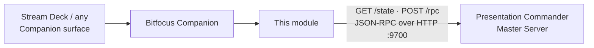

# companion-module-presentationcommander-server

> **AI-assisted project.** This codebase was created with [Claude](https://claude.com/claude-code)
> (Anthropic), directed and reviewed by a human author — including implementation
> and documentation. Check it over before you rely on it for a show.

A [Bitfocus Companion](https://bitfocus.io/companion) module for
[Presentation Commander](https://github.com/stoatworks-labs/presentation-commander-server).
It controls a running Master Server from a Stream Deck (or any other Companion surface), so
you can route outputs, recall scenes, black out, send stage notes, and drive
next/previous slide on the connected Client Nodes.

It talks to the Master Server's existing JSON-RPC automation API (`:9700`)
over plain HTTP, so there's nothing extra to install on the server end.



<!-- downloads:start -->

## Download

**[v1.1.4](https://github.com/stoatworks-labs/companion-module-presentationcommander-server/releases/tag/v1.1.4)**

This release contains:

- [`companion-module-presentationcommander-server-pkg.tgz`](https://github.com/stoatworks-labs/companion-module-presentationcommander-server/releases/latest/download/companion-module-presentationcommander-server-pkg.tgz) — npm package, 8 KB
- [`presentationcommander-server-1.1.4.tgz`](https://github.com/stoatworks-labs/companion-module-presentationcommander-server/releases/download/v1.1.4/presentationcommander-server-1.1.4.tgz) — npm package, 8 KB

All builds, checksums and release notes: [github.com/stoatworks-labs/companion-module-presentationcommander-server/releases](https://github.com/stoatworks-labs/companion-module-presentationcommander-server/releases).

<!-- downloads:end -->

## What it does

- **Actions:** Route Output, Blackout Output, Recall Scene to Output, Send
  Note to Stage, Next Slide and Previous Slide. Every output/scene/source/client
  dropdown is filled live from the Master Server's current state, so the list
  always matches what's actually configured and you never type an id by hand.
- **Feedbacks:** _Output is routed to a specific source/scene_ (light a button
  when a given output is showing what you expect) and _Client Node is online_
  (light it while a given presentation laptop is connected).
- **Variables:** `connection_status`, `client_count`, and one
  `routed_<output-id>` variable per output holding the name of whatever
  it's routed to right now (or `Unrouted`).
- It polls the Master Server every 3 seconds, and the action/feedback/variable
  choice lists and values refresh by themselves as outputs, scenes, sources or
  clients change.

## Documentation

| Doc                                      | Contents                                                                        |
| ---------------------------------------- | ------------------------------------------------------------------------------- |
| [docs/USER-GUIDE.md](docs/USER-GUIDE.md) | Building a surface, and where the feedbacks can mislead you                     |
| [docs/API.md](docs/API.md)               | Every action, feedback and variable, the config fields, and the poll loop       |
| [docs/DEVELOPING.md](docs/DEVELOPING.md) | The three-repo protocol, the module conventions, and the behaviours to preserve |

## Setup

1. Install and enable this module in Companion (see **Installing** below).
2. Add a new connection using it, and set:
   - **Master Server host:** the machine running Presentation Commander
     Master Server (default `127.0.0.1`, meaning Companion's on the same
     machine as the Master Server).
   - **Automation API port:** default `9700`, which matches the Master
     Server's built-in automation API.
3. The connection should go green once it can reach `GET /state`.

### If Companion runs on a different machine

The Master Server's automation API only listens on `127.0.0.1`, on purpose.
It runs routing and scene commands with no authentication at all, so putting it
on the network is something an operator has to choose to do, and Presentation
Commander won't do it for you. If your Stream Deck / Companion setup is on a
different machine from the Master Server, reach port `9700` through an SSH
tunnel or a reverse proxy that adds its own authentication, then point this
module's **Master Server host**/**port** fields at the tunnel or proxy rather
than the raw port.

## Installing (not yet in the Companion module store)

### From a packaged release

A GitHub Actions [release workflow](.github/workflows/release.yml) builds the
distributable `.tgz` with `companion-module-build` whenever a `v*` tag is pushed
(or when someone runs the workflow by hand from the Actions tab). Grab the
`.tgz` from the [Releases page](https://github.com/stoatworks-labs/companion-module-presentationcommander-server/releases)
once there's one up, and import it through Companion's module import
(**Modules → Import module package** in current Companion versions). You can
also build the same package yourself with `npm install && npm run package`.

### As a local developer module

```sh
git clone https://github.com/stoatworks-labs/companion-module-presentationcommander-server.git
cd companion-module-presentationcommander-server
npm install
```

Then in Companion, go to **Settings → Developer Modules** (or wherever your
Companion version keeps it) and add this folder as a local module.

## Relationship to the rest of Presentation Commander

- [presentation-commander-server](https://github.com/stoatworks-labs/presentation-commander-server):
  the Master Server this module controls. Its `src/main/services/automationApi.ts`
  is the HTTP surface this module talks to (`GET /state`, `POST /rpc`), and
  it's shared with the in-app Control Surface panel, so both paths behave the
  same.
- [presentation-commander-client](https://github.com/stoatworks-labs/presentation-commander-client):
  the Client Node app that runs on each presentation laptop. The `next-slide`/
  `previous-slide` actions here get passed on to whichever Client Node you
  target.

## Roadmap / TODO

- [ ] Submit to the official Bitfocus Companion module store (currently install-as-local-developer-module only, see "Installing" above).

## What changed in 1.1.0

**New: presets**, built from the Master Server's live outputs, sources, scenes
and clients. There's one section per output with a button for each routable
target and the tally already wired up, one section for the Client Nodes, and
stage notes.

Two details worth knowing about them:

- The blackout preset lights from the same routing feedback as the crosspoint
  buttons, comparing against the empty target. The server represents "unrouted"
  as a null `routedSourceId`, so it didn't need a feedback of its own.
- Slide buttons light when the Client Node is online, not when the slide has
  advanced. The server only forwards next/previous to a client if it's
  connected, and otherwise steps its own counter and reports success anyway, so
  online is the only signal you can trust.

**New: `npm test`**, which runs the module's actual code against a pretend
automation API on a real HTTP server. It covers the generated presets, the tally
feedbacks, and a rejected command being treated as a failure rather than a
success.

## License

MIT

<!-- attributions:start -->
This project is built on other people's work — see [ATTRIBUTIONS.md](ATTRIBUTIONS.md).
<!-- attributions:end -->
